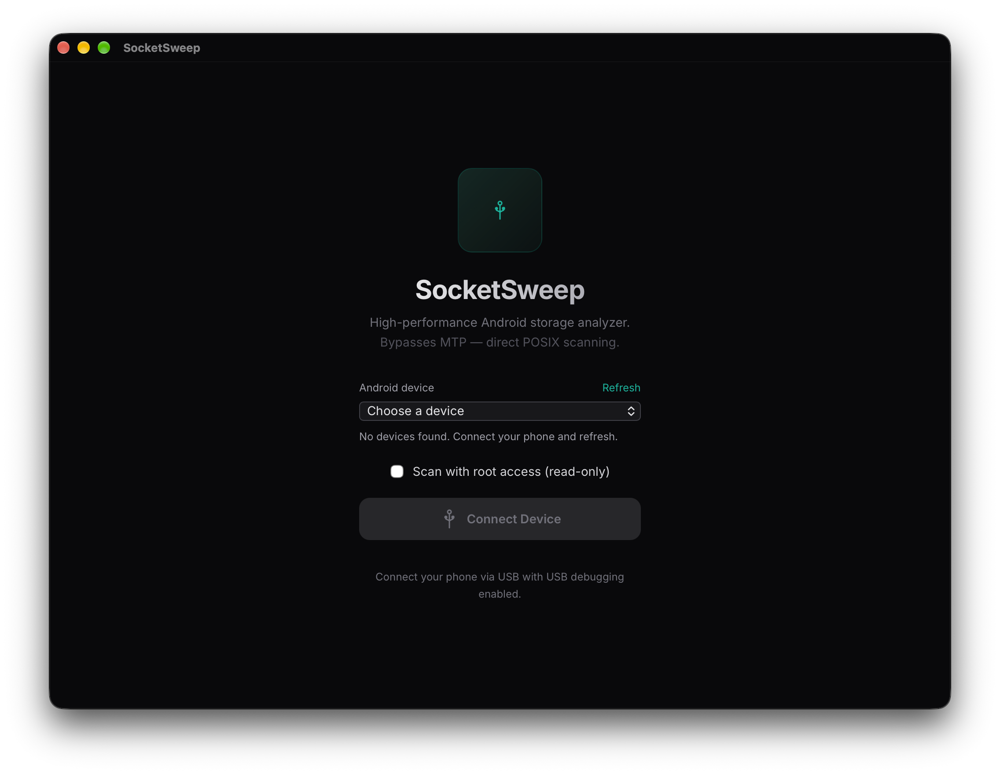
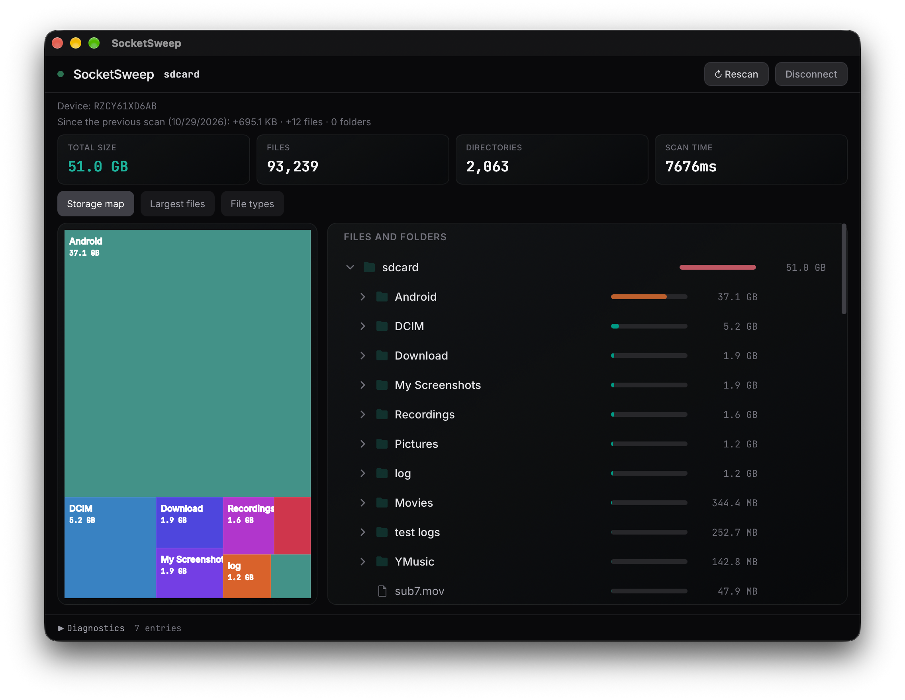
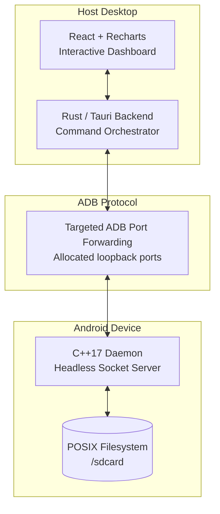
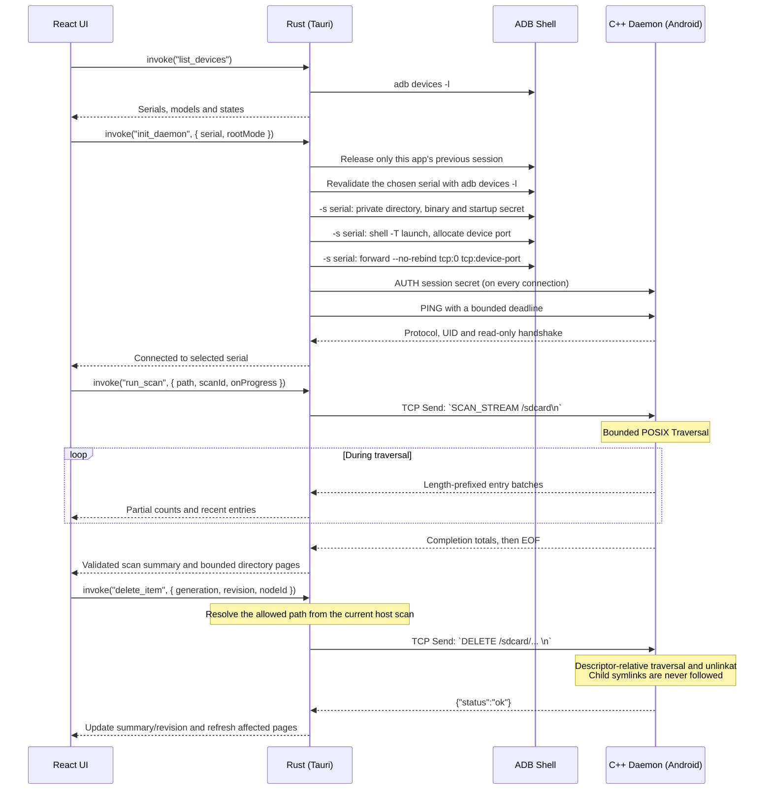

<div align="center">
  
  <h1>SocketSweep</h1>
  <p><strong>See what's eating your Android storage in seconds, not minutes.</strong></p>
  
  
  
  
  
  
  <br />
  <a href="https://github.com/sponsors/VishnuSrivatsava"></a>
</div>

<br />

<div align="center">
  <a href="https://youtu.be/ttsc6Xf6Xb4">
    
  </a>
  <br />
  <a href="https://youtu.be/ttsc6Xf6Xb4"><strong>▶ Watch the full demo and architecture breakdown</strong></a>
</div>

---

## 😤 The Problem

Ever plugged your Android phone into your PC to figure out what's eating all your storage?

Here's what happens with the standard USB connection (MTP):

- You open the phone in File Explorer / Finder
- Click on a folder with lots of files
- **"Calculating size..."** — hangs for 4+ minutes
- Eventually shows sizes, but navigating is painfully slow
- Trying to find large files? Good luck scrolling through hundreds of folders one by one

This is because **MTP (Media Transfer Protocol)** — the protocol your OS uses to talk to Android over USB — was designed in 2008 for MP3 players. It transfers file metadata one item at a time, with no caching, no parallel requests, and no way to do a fast recursive scan. It was never built for phones with 100GB+ of photos, videos, and apps.

**SocketSweep bypasses MTP entirely.**

---

## ⚡ How Fast?

Full `/sdcard` scan on a **Samsung Galaxy S24 Ultra (256GB)** with ~47,000 files:

> **SocketSweep: ~6-15 seconds** — full interactive treemap ready to explore.

Scan time varies depending on device load (background apps, media indexing, thermal state). Best case was 6.9 seconds with a warm cache and minimal background activity.

For comparison, doing the same thing over MTP (plugging in the phone and browsing via Windows Explorer or Finder) typically involves minutes of "Calculating size..." freezes, and macOS Finder doesn't even show folder sizes at all.

*Proper side-by-side benchmarks against OpenMTP and other tools are coming soon.*

---

## 📸 What It Looks Like

<div align="center">
  
  
  <br />
  <p><em>Left: Connection Dashboard | Right: Interactive Treemap — click any block to drill down</em></p>
</div>

---

## 🚀 How to Use

### 1. Download
**[Download SocketSweep v1.1.1](https://github.com/VishnuSrivatsava/SocketSweep/releases/tag/v1.1.1)**

| Platform | Download |
|----------|----------|
| 🪟 **Windows** | [Installer (.exe)](https://github.com/VishnuSrivatsava/SocketSweep/releases/tag/v1.1.1) · [Enterprise (.msi)](https://github.com/VishnuSrivatsava/SocketSweep/releases/tag/v1.1.1) |
| 🍎 **macOS** (Apple Silicon) | [Disk Image (.dmg)](https://github.com/VishnuSrivatsava/SocketSweep/releases/tag/v1.1.1) |
| 🐧 **Linux** | [AppImage](https://github.com/VishnuSrivatsava/SocketSweep/releases/tag/v1.1.1) · [.deb](https://github.com/VishnuSrivatsava/SocketSweep/releases/tag/v1.1.1) |

> **AppImage updates:** Starting with the next release, AppImages include update information and a matching `.zsync` release asset for delta updates with [AppImageUpdate](https://github.com/AppImageCommunity/AppImageUpdate). Updates follow the latest published stable release. Existing v1.1.1 downloads need one manual upgrade to an AppImage with this metadata.

> **Arch/AUR note:** The [`socketsweep-bin`](https://aur.archlinux.org/packages/socketsweep-bin) package is currently unmaintained and its checksum check fails until an adopter bumps it to v1.1.1. In the meantime, Arch users can install the .deb directly: `sudo pacman -U SocketSweep_1.1.1_amd64.deb`

> **macOS note:** Since the build is ad-hoc signed, run this once after installing:
> ```bash
> xattr -cr /Applications/SocketSweep.app
> ```

### 2. Enable USB Debugging on your phone
Go to **Settings → About Phone → tap "Build Number" 7 times** to unlock Developer Options. Then go to **Settings → Developer Options → enable "USB Debugging"**.

### 3. Plug in and scan
1. Connect your phone via USB cable
2. Open SocketSweep
3. Click **Connect** — the app will automatically push the daemon to your phone and set everything up
4. Click **Scan** — your full storage treemap loads in seconds
5. Click on any block in the treemap to drill down. Found something huge you don't need? Delete it right from the app.

That's it. No apps to install on your phone, no Wi-Fi setup, no root required.

In a source build, choose the device in setup before connecting when multiple
devices are ready. Refresh after plugging in or authorizing a phone. A selected
device that disappears stays selected and blocks connection; another phone is
never substituted automatically. See [device selection](docs/device-selection.md)
for behavior and manual checks.

### Optional: scan with root access

This option is included in source builds and the next release; v1.1.1 does not
expose it.

On an already-rooted device, enable **Scan with root access (read-only)** before
connecting. Choose **App and user data (`/data`)** to include private app files,
**Internal data and system (`/`)** for a broader internal scan, or **Shared storage
(`/sdcard`)**. Rescan keeps the current scan location.

SocketSweep uses an already-root ADB shell when available; otherwise it requests
access through `su`. Approve shell access in your phone's root manager when
prompted. On supported debug builds, you can run `adb root` yourself before
connecting. SocketSweep does not restart ADB or root your device, and refuses a
root session unless the daemon confirms UID 0 and read-only mode.

Root scans disable deletion in the UI, bridge, and daemon. A daemon running as
root is always read-only, even if the root option was left off. Disconnect and
use an ordinary non-root ADB shell to restore the normal shared-storage workflow.

The internal `/` scan excludes `/proc`, `/sys`, `/dev`, `/mnt`, `/storage`,
`/data_mirror`, and `/apex` to avoid virtual files and duplicate views of storage.
It includes internal shared media through `/data/media`; removable storage is
outside this scan's scope. Virtual filesystems are skipped elsewhere too, and
files or directories with the same device/inode identity are counted once per
root scan. Symlinks are not followed below the scan root. Totals use logical file
sizes, rather than allocated blocks, so they need not match `du` or Android's
storage screen exactly. Access errors and excluded entries are shown in results.

---

## 🧠 How It Works (The Short Version)

Instead of going through MTP, SocketSweep does something completely different:

1. **Pushes a tiny C++ program** (~1MB) to your phone via ADB
2. **That program scans the filesystem directly** on the phone using native POSIX calls — this is why it's so fast (no MTP bottleneck)
3. **Streams the results back** to your PC over a TCP socket through the USB cable
4. **Renders an interactive treemap** in a React frontend so you can visually see what's taking space

The architecture was inspired by [scrcpy](https://github.com/Genymobile/scrcpy) — the "push a native binary via ADB, communicate over a local socket" pattern.

Each connection authenticates with a fresh 256-bit session secret before the
daemon accepts a command. The secret reaches the phone through a shell-owned
startup file with mode `0600`; the daemon reads and removes that file before
listening. The app and daemon must use the same protocol version.

---

## 🏗 Architecture (For Developers)

SocketSweep has three layers:



### Interaction Lifecycle



---

## 🔧 Development Setup (Building from Source)

### Prerequisites
1. **Node.js** (`^20.19.0`, `^22.13.0`, or `>=24`, including frontend lint tooling)
2. **Rust** (v1.70+ with Cargo)
3. **Android NDK** (v26d or newer)
4. **Android SDK / ADB** installed and added to your system `$PATH`.

### 1. Compile the C++ Daemon
Cross-compile the daemon for `aarch64-linux-android`:
```bash
# Set your NDK path
export NDK=/path/to/your/android-ndk-r26d

# Build the daemon
cd engine
bash ./build.sh
```
*This generates the stripped `daemon` binary in the `engine/` directory and
copies it into `src-tauri/bin/daemon`, which Tauri bundles. Rebuild after changing
the daemon so local development uses the current protocol (v3).*

Ordinary storage scans use a bounded pool of four workers. For daemon-level
comparisons, append `--threads N` (1–8) after `PORT TOKEN_FILE`; one worker
provides a serial reference. The pending directory queue holds at most 64 jobs
and does not keep directory descriptors open. Root and `--read-only` scans
remain serial, retaining their exclusions and scan-wide inode deduplication.
The authenticated protocol and deletion checks apply to every worker setting.

The app uses scan stream v1 (advertised alongside protocol v3): bounded JSON
frames arrive during traversal, with partial counts/recent entries and a cancel
button. Successful results require verified totals, a terminal completion frame
and EOF. Rebuild the daemon before running this version locally; older v3
binaries without the streaming capability are refused. See
[the stream contract](docs/scan-stream-v1.md) for bounds, completion rules,
cancellation, timing semantics and the remaining full-tree frontend limitation.

Current startup also requires the rebuilt daemon for
[owned session files, allocated ports, and lifetime cleanup](docs/daemon-sessions.md).


### 2. Install Frontend Dependencies
```bash
cd ..
npm install
```

### 3. Run the App
```bash
npm run tauri dev
```
*Ensure your Android device is plugged in via USB and **USB Debugging** is enabled.*

### 4. Run regression tests

```bash
# macOS/Linux: compiles the host daemon and uses disposable local files
python3 -m unittest discover -s tests -v

# Frontend helper tests; no app or connected device required
npm test

# Frontend, browser fixtures, Node helpers, and Vite/ESLint configuration
npm run lint

# Build the frontend first when testing from a clean checkout
npm run build
cargo test --locked --manifest-path src-tauri/Cargo.toml --lib
```

Lint uses the recommended ESLint/TypeScript rules and React's hook-order and
effect-dependency rules. Warnings fail the gate. It does not reformat files;
keep mechanical formatting separate from behavior changes. Frontend helper
tests and lint run on every desktop CI platform; the Linux job also checks the
built UI with mocked IPC at normal size, 1024×768, and 2× scale.
EditorConfig supplies UTF-8/LF files with a final newline and the existing
two-space frontend/config and four-space Rust/C++/Python indentation defaults.

For the optional, manually run ADB/MTP copy experiment, see
[the file-transfer baseline and export plan](docs/file-transfer.md). Regression
tests use offline fixtures and mocked ADB calls; they do not contact a phone.

CI also preserves [matching daemon crash symbols](docs/daemon-symbols.md)
separately from the stripped binary bundled with the app.

The line-based protocol preserves spaces in filenames. Paths containing a
newline, carriage return, or null byte are rejected before sending, so they
cannot cause a different file to be deleted. Scan responses containing invalid
UTF-8 filenames are also rejected rather than replacing filename bytes.

Deletion is anchored to the directory opened for the successful scan. Child
directories are opened one component at a time without following symlinks, and
removal uses those handles instead of resolving the original full path again.
Detected changes to roots or directory entries stop deletion. Parent symlinks
and traversal into another filesystem are rejected. `/sdcard` root aliases remain supported.
Recursive deletion has a depth limit of 64 directories.

Deletion is not transactional: concurrent filesystem changes or permission
errors can stop it after some entries were removed. Rescan before retrying.
An operation already in progress uses the opened directory identities; renaming
a path cannot redirect it into a different directory through a new symlink.

---

## 🛠 Troubleshooting

### "0 Files" or Missing Folders on Android 11+
Android 11 introduced Scoped Storage, restricting file access. SocketSweep automatically tries to bypass this via:
```bash
adb shell appops set com.android.shell MANAGE_EXTERNAL_STORAGE allow
```
If scanning still shows nothing, check if your OEM requires extra toggles (e.g., Xiaomi needs "USB Debugging (Security settings)" enabled).

### Samsung Auto Blocker
If you're on a Samsung device and USB Debugging is greyed out, you probably have **Auto Blocker** enabled. Go to **Settings → Security → Auto Blocker** and turn it off. Auto Blocker disables USB Debugging entirely, so no ADB-based tool (including SocketSweep) will work with it on. It's off by default — you'd only have this issue if you manually turned it on.

### AppImage Fails to Launch on Arch Linux (Wayland)
If the AppImage crashes or fails to start on Arch Linux under a Wayland session, launch it with the Wayland client library preloaded:
```bash
LD_PRELOAD=/usr/lib/libwayland-client.so ./SocketSweep.AppImage
```
See [this issue](https://github.com/gitbutlerapp/gitbutler/issues/5282#issuecomment-3598600651) for more context.

### Daemon Fails to Start
If you get `Permission denied`, make sure the daemon is being pushed to `/data/local/tmp/`. Modern Android blocks execution from `/sdcard/`. SocketSweep handles this automatically.

---

## 💖 Support This Project

If SocketSweep saved you from the nightmare of MTP, consider supporting its development:

<div align="center">
  <a href="https://github.com/sponsors/VishnuSrivatsava"></a>
  &nbsp;&nbsp;
  <a href="https://paypal.me/mathcuber"></a>
</div>

---

## 📄 License

SocketSweep is released under the **GNU General Public License v3.0**. See the [LICENSE](LICENSE) file for more details.

---

## 👋 Author

Built by **Vishnu Srivatsava**. Inspired by the architecture of [scrcpy](https://github.com/Genymobile/scrcpy). Currently looking for Backend / Systems Engineering roles. Feel free to reach out on [LinkedIn](https://www.linkedin.com/in/vishnu-srivatsava-642222238/) or via [email](mailto:vishnusrivatsava@gmail.com).
